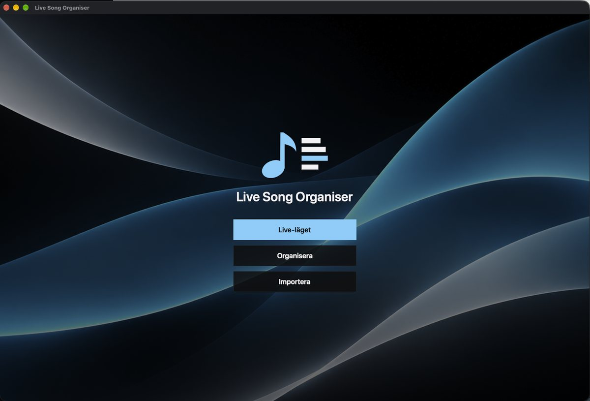

Min fru sjunger live. Hon har många A4-blad i pärmar, och dessutom noter som ska sorteras in. Efter hennes önskemål bygger jag nu en app åt henne: Live Song Organiser.

Appen är under arbete och inte släppt. Det här är en berättelse om vad jag bygger just nu och hur jag tänker. Tanken är att den ska användas på en iPad.

## Tre val på startskärmen

Startskärmen har tre knappar, och de visar hur appen är tänkt att användas.

**Live-läget.** Det är läget som används när man står på scen. Skärmen ska aldrig släckas, typsnittet ska vara tydligt och texten ska inte gå att ändra. Man laddar en lista och scrollar med fingret. Appen ska fungera både liggande och stående, beroende på stativ eller hållare.

**Organisera.** Här sorterar man, ändrar i filerna och skapar listor till olika spelningar. Det här läget ska inte kunna öppnas av misstag. Min idé är en knapp i ett hörn som man håller inne i tre sekunder.

**Importera.** Här hämtar man in sina filer, via Filer-appen. Materialet är mest inskannade A4-blad med text och ackord som bara ska visas.

## Två lägen så att inget går fel

Jag har delat upp appen i två lägen. I Live-läget går det inte att ändra något och ingenting kan öppnas av misstag. I Organisera sköter man ordningen i lugn och ro, innan det är dags att gå upp på scen.

## Idéer längre fram

Det här är sådant jag vill kunna göra, men som inte finns i appen än:

- **OCR.** Läsa in de skannade bladen så att texten blir skriven text, där appen själv styr typsnitt och storlek.
- **Byta färg på texten.**
- **Skriva med Apple Pencil.**
- **Byta typsnitt** på texten.
- **Koppla musiktjänster till appen.**

Det här är idéer och inga löften. Jag tittar på dem först när grunden fungerar.
