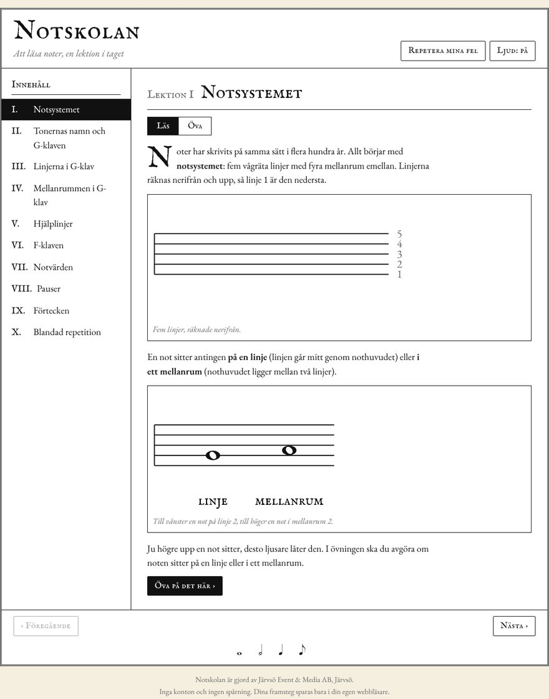

Noter ser svåra ut för den som aldrig har lärt sig dem. Egentligen är grunderna få: fem linjer, en klav och ett par regler. Därför har jag byggt Notskolan, en webbapp på svenska som tar dig igenom de grunderna i små steg.

Notskolan är ett nytt projekt och är inte klar. Du kan använda den redan nu, men jag vill vara tydlig med att den ännu är en prototyp som behöver granskas av fler som kan noter.

## Tio lektioner

Varje lektion har två delar: en där du läser och en där du övar.

1. Notsystemet
2. Tonernas namn och G-klaven
3. Linjerna i G-klav
4. Mellanrummen i G-klav
5. Hjälplinjer
6. F-klaven
7. Notvärden
8. Pauser
9. Förtecken
10. Blandad repetition

Notbilderna är ritade i webbläsaren och är inga stillbilder. De musikaliska tecknen, som klaver och pauser, kommer från ett riktigt notteckensnitt. Utseendet är medvetet svartvitt och lite gammaldags, så att fokus hamnar på noterna.

## Inga konton, ingen spårning

Notskolan kräver ingen inloggning. Dina framsteg sparas bara i den webbläsare du övar i, och ingenting skickas till någon server. Det betyder också att framstegen inte följer med till en annan enhet, och att de försvinner om du rensar webbläsarens data.

## Hur den blev till

Idén kom från en inkorg jag har på min egen översiktssida. Första versionen byggdes av Claude utifrån idén. Sedan har jag gått igenom den och rättat fel, bland annat var F-klavens placering och förtecknens läge på notlinjerna inte riktigt rätt från början. Just notskrift är något som AI ofta ritar fel, så en granskning av någon som kan noter är nödvändig. Hittar du något som ser fel ut får du gärna höra av dig via [kontaktsidan](/kontakt/).

Om den blir användbar kan den bli en app. Då flyttar jag den till ett eget projekt.

## Prova Notskolan

- [Notskolan](https://notskolan.vercel.app)

Notskolan är gjord av Järvsö Event & Media AB.
